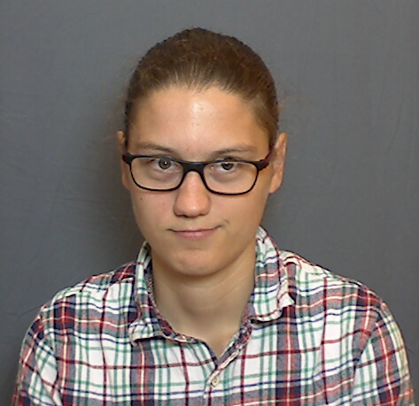

::: {.hero .column-screen}
::: {.hero-content}
[Claire Morel]{.hero-title}

[Maître de Conférences · Institut Clément Ader · Université de Toulouse]{.hero-subtitle}

<a class="btn btn-light" href="https://orcid.org/0000-0002-0689-7838"><i class="bi bi-person-badge"></i> ORCID</a>
<a class="btn btn-light" href="https://scholar.google.com/citations?user=auK-vRMAAAAJ&hl=fr"><i class="bi bi-mortarboard"></i> Scholar</a>
<a class="btn btn-light" href="https://github.com/clmorel"><i class="bi bi-github"></i> GitHub</a>
<a class="btn btn-light" href="mailto:claire.morel@utoulouse.fr"><i class="bi bi-envelope"></i> Email</a>
:::
:::

:::: {.columns .presentation}
::: {.column width="30%"}
{.photo-profil}
:::

::: {.column width="70%"}

Je suis Maître de Conférences à l'**Université de Toulouse**, au sein de la
filière Génie Mécanique, et je mène
mes recherches à l'**Institut Clément Ader** (ICA, CNRS UMR 5312), dans le
groupe Matériaux et Structures Composites.

Mes travaux portent sur la **caractérisation et la modélisation du comportement
mécanique des matériaux composites**, en particulier des composites à matrice
céramique (CMC). Je m'intéresse à leur comportement élastique et
endommageable, en m'appuyant sur des campagnes expérimentales instrumentées et
sur un dialogue essais-calcul à différentes échelles.
:::
::::

## Activités de recherche

- **Modélisation mésoscopique des composites** : comportement
  thermo-mécanique et endommagement à l'échelle du pli (Discrete Ply Model),
  appliqués aux composites à matrice organique et aux CMC oxyde ; approches
  global/local pour la propagation de défauts dans les structures de lanceurs
  spatiaux.
- **Modélisation microscopique des CMC** : volumes élémentaires représentatifs,
  modèles de shear-lag et rupture probabiliste de composites SiC/SiC.
- **Caractérisation expérimentale** : essais multi-instrumentés (corrélation
  d'images, thermographie infrarouge) sur CMC SiC/SiC, CMC oxyde/oxyde et
  composites à fibres naturelles.
- **Usinabilité et réparation des CMC** : usinage non débouchant par jet d'eau
  abrasif et assemblage de CMC oxyde/oxyde.

[Voir le détail de mes activités de recherche →](research.qmd)

## Enseignement

J'enseigne la mécanique des structures et des matériaux, de la Licence 2 au
Master 1, à l'Université de Toulouse :

- **Licence** : Mécanique des Milieux Continus, Résistance Des Matériaux,
  Informatique scientifique
- **Master Génie Mécanique en Aéronautique** : Fatigue-rupture, fabrication
  et dimensionnement des structures composites, projets de recherche, concours 
  *Pont Composite* organisé par SAMPE France.

[Voir le détail de mes enseignements →](teaching.qmd)

## Parcours

- **2023-...** — Maître de Conférences, Université de Toulouse / Institut Clément Ader
- **2022–2023** — ATER, IUT Génie Mécanique et Productique, Université Toulouse 3 – Paul Sabatier
- **2019–2023** — Doctorat, Laboratoire de Mécanique Paris-Saclay (LMPS) et CEA Saclay :
  *Influence de défauts de fabrication sur le comportement mécanique de composites tubulaires SiC/SiC*
- **2015–2019** — Élève normalienne, ENS Paris-Saclay, département de Génie Mécanique ;
  agrégation externe de sciences industrielles de l'ingénieur (2018)

<!-- [Voir le détail de mon CV →](teaching.qmd) -->
<!-- ## Collaborations

**Académiques** : LMPS (Gif-sur-Yvette), National University of Singapore (NUS).
**Industrielles** : Safran Ceramics, CNES, CT Ingénierie, Segula Technologies. -->